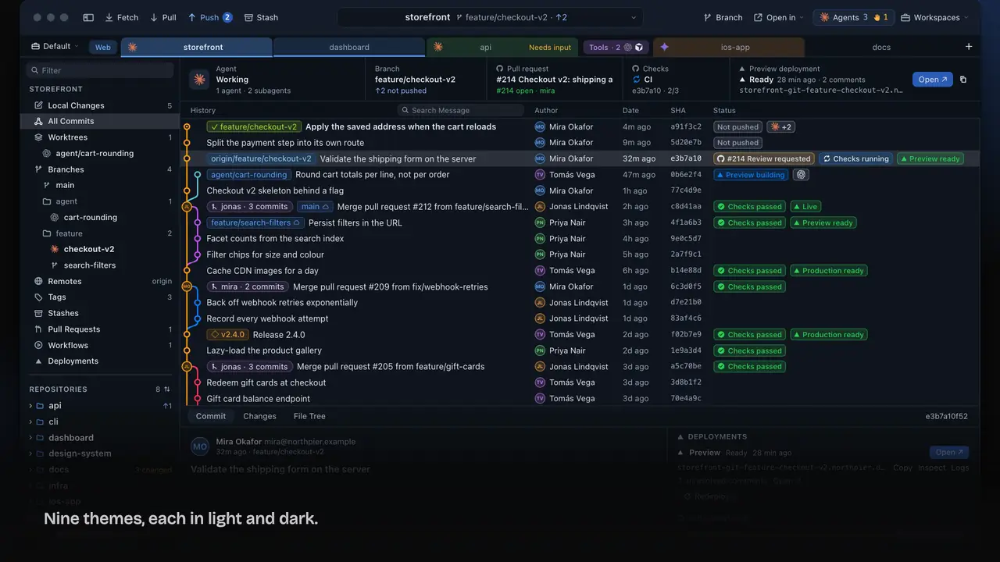

<p align="center"></p>

<h1 align="center">Gitā</h1>

<p align="center">A native macOS Git client built around repository history.<br>Swift + AppKit · macOS 14 and later · Apple Silicon and Intel</p>

<p align="center"></p>

## Features

**Agents at a glance.** Claude Code, Codex and others appear next to the commits they belong to, and Gitā tells you when one needs you.


**Tab groups and workspaces** keep sets of repositories apart.


**History you can read:** merges that fold, and one author highlighted or shown alone.


**GitHub:** pull requests, checks and previews on their commits, workflow runs down to the failed step, review and merge.


**Vercel:** every deployment on its commit; promote, roll back and redeploy.


**Yours:** themes, colours and fonts.



**Keyboard first:** ⌘K searches every command, branch, pull request and commit.


**Menu bar inbox:** what needs you, then the agents at work, then every workspace.


## In detail

Gitā shows dense, zoomable all-branch history in repository tabs, with reference filtering, full-history search,
lazy commit trees, parent comparisons, file and hunk staging, clone and init, branch operations, fetch/pull/push,
stash and worktrees. Merge, rebase (including interactive rebase), cherry-pick and revert have review sheets and
continue/skip/abort controls; their conflicts open in a three-way merge editor in Local Changes (Current, Result,
Incoming, change by change, with simple conflicts merged in one click). Pull requests, CI, Vercel deployments and live coding-agent
sessions (Claude Code, Codex and others) appear next to the commits they belong to. A pull request opens in its own
review window: its conversation and every changed file, line comments, replies and resolved threads, a review
submitted as Comment, Approve or Request changes, and Merge as a merge commit, squash or rebase, through your `gh`
session, with a Terminal button for the repository's folder. A menu bar panel, notifications and an
Activity window keep track of work across repositories. The panel is an inbox: first what needs you (an agent
waiting for input, a review requested from you, failing checks, conflicts), each with the one button that answers it;
then the agents at work; then every workspace with its tabs, where a click opens the workspace or a tab.

Settings ▸ General ▸ Terminal picks the terminal "Open in Terminal", "Review with …" and the pull request's Terminal
button use: Terminal, iTerm, Ghostty and the others, or **Built-in Terminal**. The built-in one is a plain terminal
inside Gitā: your login shell in the folder, shown by [xterm.js](https://xtermjs.org) in a web view, in the colours
of your Gitā theme (Settings ▸ General ▸ Terminal colours: dark, light or matching the app). Its terminals open as
tabs in a panel along the bottom of the main window: View ▸ Show Terminal (⌃\`) shows or hides it, View ▸ New
Terminal (⌃⇧\`) opens a shell in the open repository, both changeable in Settings ▸ Shortcuts. The panel opens at the
height you last dragged it to, as a share of the window (30% at first). Closing a tab, or the window, hangs up the
program running in it; Gitā asks before closing a window, or switching its workspace, while terminals are open in it.

Workspaces keep sets of repositories apart: each has its own tabs and its own list of recent repositories. Gitā
starts with one, named Default. The button at the start of the tab bar (and File ▸ Workspace) lists them, switches
between them, and adds, renames and deletes them; deleting a workspace forgets its tabs and its list, never a
repository. Choosing a workspace shows it in the window, in place of the one there. With Settings ▸ General ▸
Workspaces ▸ **Open each workspace in its own window** on, it opens in a window of its own instead, and choosing a
workspace that already has a window brings that window forward. The menu bar panel lists every workspace, in front,
in another window or closed, and it and the notifications follow the repositories of every workspace.

Gitā has no account and stores no credentials. Provider data comes from the CLIs you already use (`git`, `gh`,
`vercel`, agent CLIs) with their own sessions.

## Build and run

```sh
scripts/build.sh                              # release build into build/app.noindex/Gita.app
CONFIG=release ARCH=universal scripts/build.sh  # Apple Silicon + Intel
PACKAGE_ZIP=1 scripts/build.sh                # also build build/Gita-<version>-macos.zip + .sha256 and verify it
scripts/install.sh                            # installs to /Applications/Gita.app and opens it
scripts/check-one-copy.sh                     # verifies a single /Applications/Gita.app install
scripts/perf.sh idle                          # measures idle CPU %, RSS MiB and wakeups
```

Requires Xcode 26 or later (Swift 6.2). Release archives ship as universal `Gita-<version>-macos.zip` bundles with
automatic [Sparkle 2](https://sparkle-project.org) updates verified by EdDSA from
`https://getgita.app/appcast.xml` (no telemetry, no account or license key). The built-in terminal's xterm.js is
bundled as a resource with its license. See [docs/releasing.md](docs/releasing.md) for signing, notarization and
release verification.

⌘K opens the command palette: one search over every menu command, the branches, pull requests, workflow runs,
deployments, repositories, commits and Settings panes. Type a few words (a slip such as "psuh" still finds Push), Tab
narrows to one kind, Return runs the selected row; ⇧⌘K opens it on the branches alone.

Open a repository with ⌘O or ⌘T. ⌘1…⌘9 choose a tab; ⌥⌘1 History, ⌥⌘2 Changes, ⌥⌘3 Worktrees. ⌘R refreshes,
⌘, opens Settings, ⌘+/⌘−/⌘0 zoom the history. Git writes happen only from explicit actions; pull is
fast-forward-only and worktree removal never forces away uncommitted files.

## Test and quality gate

```sh
scripts/test.sh            # unit and integration tests (Swift Testing)
scripts/quality.sh         # full local gate: lint, metrics, dead code, duplication, coverage, CRAP
scripts/install-hooks.sh   # runs scripts/quality.sh before every git push
scripts/sonar.sh           # the same analyses, uploaded to SonarQube (needs a local .sonar.txt)
```

Integration tests create real, disposable Git repositories in a temporary directory; they never touch your own
repositories. The gate thresholds are listed in [CONTRIBUTING.md](CONTRIBUTING.md#quality-gate).

## Layout

| Path | Contents |
| --- | --- |
| `Sources/GitaCore` | No AppKit. `Git/` (the `git` CLI: history, working tree, references, remotes, reset, rebase, diff), `Providers/` (GitHub, Vercel, Orca), `Agents/` (coding-agent detection, hooks, integrations), `Process/`, `Support/`, `Review/`, `Setup/`, `Tabs/`. |
| `Sources/GitaUI` | AppKit. `App/` (delegate, menus, commands, status item), `Model/` (per-repository state), `Repository/` (the main window: history, sidebar, detail, toolbar), `CommitDetail/`, `Changes/`, `Sheets/` (review sheets), `Tabs/`, `Workspaces/`, `MenuBar/`, `Notifications/`, `Agents/`, `Settings/`, `Setup/`, `Terminal/` (the built-in terminal), `Windows/`, `Shared/` (theme, views, shared controls). |
| `Sources/GitaApp` | The app entry point. |
| `Sources/GitaAgentHelper` | `gita-agent`, the hook helper agent CLIs call. |
| `Tests/` | `GitaCoreTests` and `GitaUITests`, mirroring the source folders. |
| `Resources/` | String catalogs, plurals, the app icon (`AppIcon.icns`, rebuilt from the Gitā icon kit by `scripts/artwork.swift`; the build also compiles it into `Assets.car`), bundled fonts, agent logos, review skills, the README media (`README/`) and the built-in terminal's page (`Terminal/`, with xterm.js). |
| `Config/` | Product settings (bundle id, version, URL scheme). |
| `scripts/` | Build, install, test, localization and quality tooling. |
| `Tools/QualityMetrics` | The complexity, Halstead, CRAP and file-size checker used by the gate. |

## Review skills

"Review with Claude" (or the agent chosen in Settings › AI Agents › AI Review › Agent) hands the agent one of these
skills, chosen in Settings › AI Agents › AI Review › Review. They are bundled in
[`Resources/ReviewSkills/`](Resources/ReviewSkills), each folder holding the skill's `SKILL.md` and its license: the
third-party skills unmodified, and Gitā's own in [`gita-review`](Resources/ReviewSkills/gita-review/SKILL.md).

The review runs in the terminal chosen in Settings ▸ General (a Terminal window by default) with the agent's
permission prompts turned off, so it can read the range
without stopping to ask. Review only branches you trust, as you would before running their code.

| Skill | Source | Author | License |
| --- | --- | --- | --- |
| Matt Pocock Review | [mattpocock/skills › code-review](https://github.com/mattpocock/skills/blob/main/skills/engineering/code-review/SKILL.md) | Matt Pocock | MIT |
| Thermo-Nuclear Review | [cursor/plugins › thermos](https://github.com/cursor/plugins/blob/main/thermos/skills/thermo-nuclear-code-quality-review/SKILL.md) | Cursor | MIT |
| Caveman Review | [JuliusBrussee/caveman › caveman-review](https://github.com/JuliusBrussee/caveman/tree/main/skills/caveman-review) | Julius Brussee | Apache-2.0 |
| Gitā Review | [clever-mechanisms/gita › gita-review](https://github.com/clever-mechanisms/gita/blob/main/Resources/ReviewSkills/gita-review/SKILL.md) | Gitā | MIT |

## License

Gitā is released under the [MIT license](LICENSE). Bundled third-party material keeps its own license, shipped
beside it:

| Bundled | Where | License |
| --- | --- | --- |
| Code fonts (16 families) | [`Resources/Fonts/`](Resources/Fonts) | SIL Open Font License 1.1 (`OFL.txt` in each folder) |
| Hack | [`Resources/Fonts/hack/`](Resources/Fonts/hack) | MIT and Bitstream Vera (`LICENSE.md`) |
| Agent logos (LobeHub Icons) | [`Resources/AgentMarks/`](Resources/AgentMarks) | MIT, © 2023 LobeHub |
| GitLab and Bitbucket marks (Simple Icons) | [`Resources/ProviderMarks/`](Resources/ProviderMarks) | CC0 1.0 (`LICENSE.md`) |
| Review skills | [`Resources/ReviewSkills/`](Resources/ReviewSkills) | MIT, Apache-2.0 (table above) |
| xterm.js 6.0.0 and its fit add-on 0.11.0, unmodified | [`Resources/Terminal/xterm/`](Resources/Terminal/xterm) | MIT (`LICENSE`, `LICENSE-addon-fit`) |

The logos remain trademarks of their owners.
